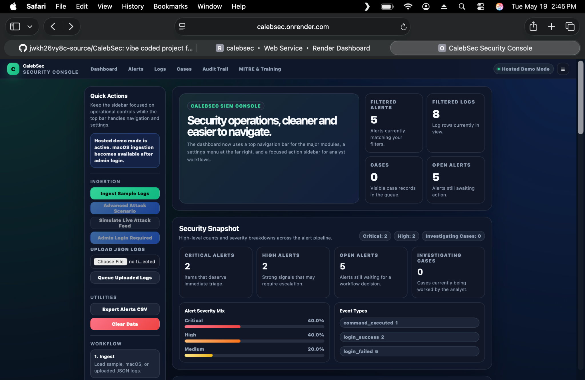
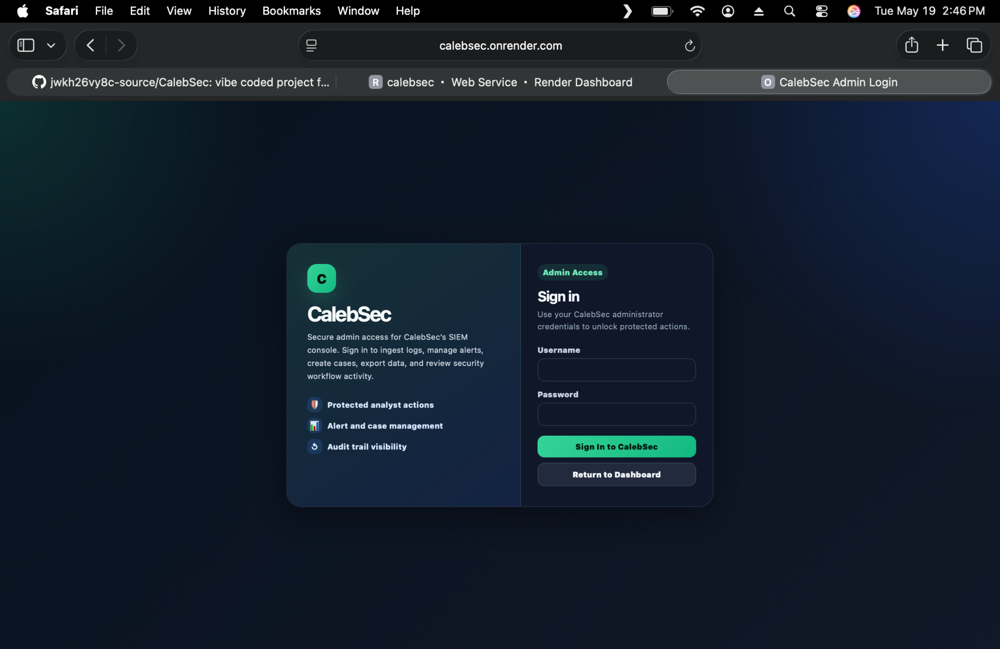
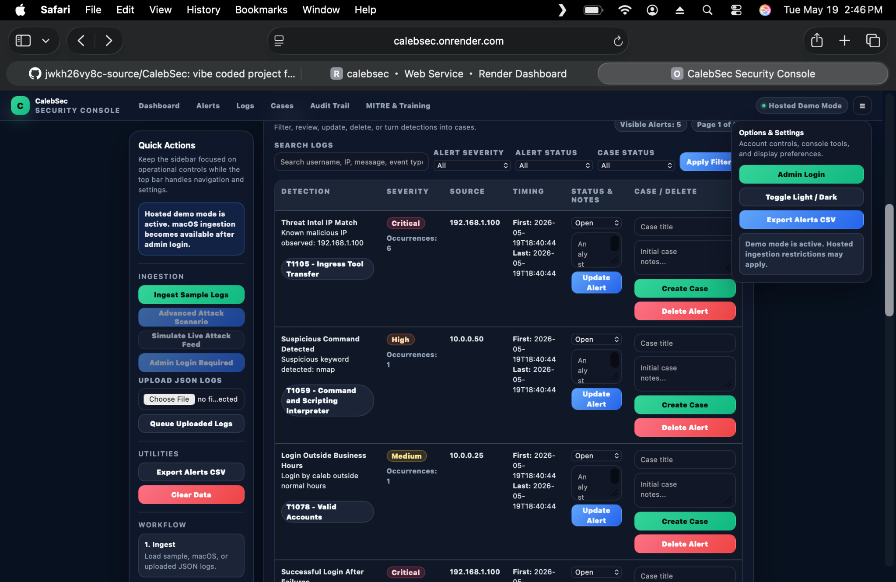
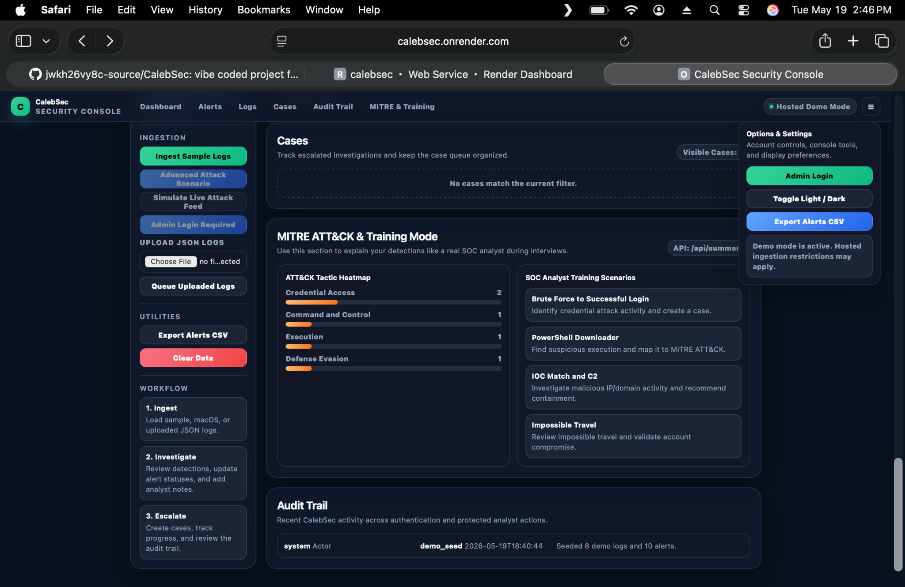

# CalebSec Security Operations Platform

CalebSec is a modular SOC-style cybersecurity platform built with **FastAPI**, **SQLite**, and a modern web dashboard. It is designed to simulate real security operations workflows including SIEM monitoring, alert triage, IOC enrichment, MITRE ATT&CK mapping, phishing analysis, case tracking, audit logging, and analyst investigation notes.

---

## Project Purpose

This project was built as a hands-on cybersecurity portfolio project to demonstrate practical blue-team and SOC analyst skills. CalebSec simulates how security teams collect logs, review alerts, investigate suspicious activity, enrich indicators of compromise, and document findings.

---

## Key Features

- SIEM-style dashboard
- Security log ingestion
- Alert monitoring
- SOC alert triage workflow
- Threat intelligence / IOC lookup
- Local IOC risk scoring
- MITRE ATT&CK mapping
- Case management
- Analyst notes
- Audit trail
- Phishing detection capability
- Suspicious activity simulation
- Hosted demo mode
- FastAPI backend
- SQLite database
- Render deployment support

---

# SOC Modules

## Dashboard

The main dashboard provides a high-level overview of current alerts, logs, open cases, and security activity.

---

## SOC Alert Triage

The SOC triage module allows analysts to review simulated security alerts, assign statuses, add notes, and track investigation decisions.

### Supported statuses

- New
- Investigating
- Escalated
- Resolved
- False Positive

---

## Threat Intelligence

The threat intelligence module supports IOC lookups for:

- IP addresses
- Domains
- URLs
- Hashes
- Suspicious command strings

Each lookup produces:

- Risk score
- Verdict
- MITRE mapping
- Summary of suspicious indicators

---

## MITRE ATT&CK Mapping

Alerts and suspicious behaviors are mapped to MITRE ATT&CK techniques such as:

- T1110 – Brute Force
- T1059.001 – PowerShell
- T1071 – Application Layer Protocol
- T1566 – Phishing
- T1204 – User Execution

---

# Example Use Cases

- Investigating brute-force login activity
- Reviewing suspicious PowerShell behavior
- Identifying potential malware beaconing
- Analyzing phishing indicators
- Enriching suspicious IPs and domains
- Tracking analyst investigation notes
- Simulating SOC alert response workflows

---

# Technology Stack

- Python
- FastAPI
- SQLite
- Jinja2 Templates
- HTML/CSS
- Render
- GitHub

---

# Project Structure

```text
CalebSec/
├── main.py
├── database.py
├── detection.py
├── soc_extensions.py
├── threat_intel.py
├── templates/
│   ├── dashboard.html
│   ├── soc_triage.html
│   └── threat_intel.html
├── static/
├── docs/
│   ├── portfolio_summary.md
│   ├── soc_workflow.md
│   ├── threat_intel_workflow.md
│   └── resume_bullets.md
├── screenshots/
└── README.md
```

---

# How to Run Locally

Clone the repository:

```bash
git clone https://github.com/CalebSecurity1998/CalebSec.git
cd CalebSec/calebsec_siem_pro
```

Create and activate a virtual environment:

```bash
python -m venv venv
source venv/bin/activate
```

Install dependencies:

```bash
pip install -r requirements.txt
```

Run the application:

```bash
uvicorn main:app --reload
```

Open the app:

```text
http://127.0.0.1:8000
```

---

# Important Routes

```text
/                 Main dashboard
/alerts           Alerts
/logs             Logs
/cases            Cases
/audit            Audit trail
/mitre            MITRE & training
/soc-triage       SOC alert triage
/threat-intel     Threat intelligence lookup
```

---

# Screenshots

## Dashboard Overview



## Admin Login



## Alert Investigation



## MITRE ATT&CK Training



```text
screenshots/dashboard.png
screenshots/soc-triage.png
screenshots/threat-intel.png
screenshots/alerts.png
screenshots/cases.png
```

Then reference them like this:

```markdown


```

---

# Portfolio Value

This project demonstrates:

- Security operations knowledge
- Alert triage workflow understanding
- Threat intelligence concepts
- Detection engineering fundamentals
- MITRE ATT&CK familiarity
- Incident response documentation
- Python web application development
- Database-backed security tooling
- Practical blue-team project experience

---

# Interview Talking Points

- Built a FastAPI-based SOC platform to simulate alert triage and investigation workflows.
- Added IOC enrichment and threat scoring to support analyst decision-making.
- Implemented MITRE ATT&CK mapping for suspicious behaviors and detections.
- Developed case management and analyst note workflows similar to real SOC tooling.
- Added phishing analysis and suspicious activity simulations to demonstrate incident response concepts.
- Designed detection logic for brute force attacks, PowerShell abuse, malware beaconing, and credential theft scenarios.
- Implemented audit logging, role-protected actions, session security, and rate limiting.
- Deployed the platform publicly using Render and maintained the project through GitHub workflows.

---

# Future Improvements

Planned future enhancements include:

- Email header analysis
- Cloud security monitoring
- Threat feed integrations
- Analyst metrics dashboard

---

# Add-On Modules

The following add-on modules extend CalebSec with additional SOC platform capabilities focused on access control, real-time telemetry ingestion, and detection engineering.

---

## RBAC / Authentication Add-On

CalebSec includes a role-based access control and authentication layer to simulate how real SOC platforms restrict access based on analyst responsibilities.

### Purpose

The RBAC and authentication module provides controlled access to CalebSec features by assigning users specific roles and permissions. This helps demonstrate secure application design, least-privilege access, and analyst workflow separation.

### Capabilities

- User authentication with username and password login
- Secure password hashing
- Bearer token-based API authentication
- Role-based route protection
- SQLite-backed user storage
- Default user roles for SOC workflows

### Supported Roles

| Role | Purpose |
| --- | --- |
| `admin` | Full platform access, user management, rule reloads, log ingestion, alerts, and events |
| `analyst` | Operational SOC access for ingesting logs, reviewing alerts, reviewing events, and reloading rules |
| `viewer` | Read-only access to events, alerts, and detection rules |

### Example Permissions

| Permission | Admin | Analyst | Viewer |
| --- | :---: | :---: | :---: |
| Read users | Yes | No | No |
| Create users | Yes | No | No |
| Ingest logs | Yes | Yes | No |
| Read events | Yes | Yes | Yes |
| Read alerts | Yes | Yes | Yes |
| Read rules | Yes | Yes | Yes |
| Reload rules | Yes | Yes | No |

### Default Local Development Account

When the database is initialized, a default local admin account is created:

| Username | Password | Role |
| --- | --- | --- |
| `admin` | `ChangeMe123!` | `admin` |

> This account is intended for local development only and should be changed before any public or production-style deployment.

---

## Live Log Ingestion Add-On

The live log ingestion module allows CalebSec to receive and process security events in real time.

### Purpose

This module simulates how a SIEM or SOC platform collects telemetry from systems, applications, and security tools. Incoming logs are normalized into CalebSec events and evaluated against loaded detection rules.

### Capabilities

- REST API log ingestion through `POST /ingest`
- Optional live file tailing for local log simulation
- JSON-line log parsing
- Plain-text fallback parsing
- Real-time alert generation when logs match Sigma-style rules
- In-memory event and alert queues for fast local prototyping

### Example JSON Log Event

```json
{
  "source": "windows",
  "event_id": 4625,
  "message": "Failed password for admin from 10.0.0.8",
  "user": "admin",
  "src_ip": "10.0.0.8"
}
```

### Example Plain-Text Log Event

```text
Failed password for root from 10.0.0.6
```

### Live File Tailing Example

```bash
python -m calebsec.main --serve --tail sample_logs/auth.log
```

Then append a test event:

```bash
echo '{"source":"linux-auth","message":"Failed password for root from 10.0.0.5","user":"root","src_ip":"10.0.0.5"}' >> sample_logs/auth.log
```

---

## Sigma Rule Support Add-On

CalebSec includes lightweight Sigma-style detection rule support to demonstrate detection engineering concepts.

### Purpose

Sigma is a common open rule format used to describe detection logic across security platforms. This add-on allows CalebSec to load YAML-based Sigma-style rules and match incoming events against those detections.

### Capabilities

- Loads `.yml` and `.yaml` rules from the `rules/` directory
- Matches incoming log events against detection logic
- Generates alerts when rules match
- Supports common starter Sigma detection patterns
- Allows rules to be reloaded without restarting the server

### Supported Detection Logic

The current lightweight matcher supports:

- `selection` maps
- Field equality
- Field lists
- `field|contains`
- Keyword lists
- `condition: selection`
- `condition: selection1 or selection2`
- `condition: selection1 and selection2`

> This is a lightweight Sigma-compatible matcher for portfolio and learning use. It is not a full Sigma backend or compiler implementation.

### Example Sigma-Style Rule

```yaml
id: failed-login-root
title: Failed Login for Root
level: high
detection:
  selection:
    message|contains: "Failed password"
    user: "root"
  condition: selection
```

### Example Multi-Selection Rule

```yaml
id: suspicious-admin-login-failure
title: Suspicious Admin Login Failure
level: medium
detection:
  selection1:
    message|contains: "Failed password"
  selection2:
    user:
      - "admin"
      - "administrator"
  condition: selection1 and selection2
```

### Rule Reload Example

After adding or editing rules, reload them with:

```bash
curl -X POST http://127.0.0.1:8000/rules/reload \
  -H "Authorization: Bearer $TOKEN"
```

---

## Add-On API Endpoints

| Method | Endpoint | Purpose |
| --- | --- | --- |
| `POST` | `/auth/login` | Authenticate and receive a bearer token |
| `GET` | `/users` | List users |
| `POST` | `/users` | Create a new user |
| `POST` | `/ingest` | Ingest a log event |
| `GET` | `/events` | View recent ingested events |
| `GET` | `/alerts` | View generated alerts |
| `GET` | `/rules` | List loaded detection rules |
| `POST` | `/rules/reload` | Reload Sigma-style rules from disk |

---

## Running the Add-On Locally

Install dependencies and initialize the database:

```bash
pip install -r requirements.txt
python -m calebsec.main --init-db
```

Start the API server:

```bash
python -m calebsec.main --serve
```

Start the API server with live file ingestion:

```bash
python -m calebsec.main --serve --tail sample_logs/auth.log
```

Run the local detection demo without starting the API:

```bash
python run_demo.py
```

---

## Security Notes

This add-on is designed for local development, portfolio demonstration, and SOC workflow simulation. Before using it in a production-style deployment:

- Change the default admin password
- Set a strong `CALEBSEC_SECRET`
- Put the API behind TLS
- Add login rate limiting
- Add account lockout controls
- Persist events and alerts to a database
- Add audit logging for login, rule reloads, and user management
- Expand Sigma support if full Sigma compatibility is required

---

## Current Add-On Limitations

- Events and alerts are stored in memory and reset when the process restarts
- SQLite user storage is intended for local and development use
- Bearer tokens are stateless and cannot currently be revoked before expiration
- Sigma support covers common starter detections, not the full Sigma specification
- File tailing reads newly appended lines only and does not backfill older file contents at startup

---

# Suricata, Zeek, and SOAR Network Operations Upgrade

CalebSec offers an **optional network sensor and SOAR integration pack** designed for the existing `calebsec_siem_pro/` FastAPI application. These features become available **only after installing the pack** and configuring external sensors.

The integration extends the existing SQLite-backed SIEM without replacing the dashboard, alerts, cases, or authentication.

## Capabilities

| Module | Included functionality |
| --- | --- |
| Suricata | Ingest EVE JSON/JSONL events; map intrusion signatures and severities into CalebSec alerts |
| Zeek | Ingest JSON `conn`, `dns`, `http`, `ssl`, `notice` and other network logs; search network history |
| Correlation | Associate events by Community ID, or by network tuple and timestamp when available |
| SOAR | Local IOC-list enrichment; playbook execution history; audit records; optional case creation for high/critical Suricata alerts |

## Install

1. Back up your local CalebSec checkout and SQLite database. Download and extract `CalebSec_Suricata_Zeek_SOAR_Upgrade_with_README.zip`.
2. From the extracted ZIP directory run:

   ```bash
   python install.py --repo /path/to/CalebSec
   ```

3. Review `git diff` and `git status` in your repository checkout. The installer adds `calebsec_siem_pro/network_ops/`, registers a router in `calebsec_siem_pro/main.py`, and adds the integration documentation to the root `README.md`. Local `.bak` files must **not** be committed.
4. Set a strong private sensor token (keep it out of source control):

   ```bash
   export CALEBSEC_SENSOR_TOKEN="$(python -c 'import secrets; print(secrets.token_urlsafe(36))')"
   ```

5. Start the existing SIEM as usual:

   ```bash
   cd /path/to/CalebSec/calebsec_siem_pro
   pip install -r requirements.txt
   python -m uvicorn main:app --reload
   ```

6. Sign in as an administrator, then open `http://127.0.0.1:8000/network-ops`.

## Ship Sample Sensor Events

With CalebSec running and the **same** `CALEBSEC_SENSOR_TOKEN` configured in the API process and your local shell, run these from the extracted ZIP directory:

```bash
curl -X POST http://127.0.0.1:8000/api/network-ops/ingest/suricata \
  -H "Authorization: Bearer $CALEBSEC_SENSOR_TOKEN" \
  -H "Content-Type: application/x-ndjson" \
  --data-binary @examples/suricata-eve.jsonl

curl -X POST http://127.0.0.1:8000/api/network-ops/ingest/zeek \
  -H "Authorization: Bearer $CALEBSEC_SENSOR_TOKEN" \
  -H "Content-Type: application/x-ndjson" \
  --data-binary @examples/zeek-conn.jsonl
```

The API accepts JSON objects, arrays, and JSONL batches up to 2 MiB and 1,000 records per request.

Use `X-Zeek-Log-Type: dns` (or another log type) for Zeek records whose log type cannot be inferred.

Configure Zeek to emit **JSON**, not its default TSV output.

Production sensors require their own network deployment and a reliable HTTPS collector. Installing this pack does **not** install sensors, inspect traffic automatically, or start a shipping daemon.

A basic local example is included in `scripts/ship_jsonl.py`.

## SOAR and Security Controls

- `CALEBSEC_AUTO_SOAR=true` by default: safe triage and case creation for high/critical Suricata alerts; set `false` to disable automatic execution.
- `CALEBSEC_NETWORK_MAX_AGE_MINUTES=10` by default: cross-source correlation window.
- No automatic firewall changes, endpoint isolation, or externally executed response actions are included. Suggested IP blocking is **review-only**.
- IOC enrichment uses a local list, not external IP reputation APIs.
- Sensor ingestion uses a bearer token.
- Network UI and manual actions require the existing CalebSec admin session, and interactive actions use CSRF protection.
- Always configure HTTPS, strong admin/session secrets, retention policies, and least-privilege network access before any externally exposed deployment.
- Hosted FastAPI on Render/GitHub cannot passively capture your local network.

## Tests and Limits

Run the included integration tests from the extracted upgrade folder:

```bash
python -m unittest discover -s tests -v
```

This is a portfolio/lab feature, not a certified production IDS/SOAR product.

Existing CalebSec alert deduplication and SQLite limitations still apply.

See `README_INSTALL.md` in the pack for additional details.

---

# Disclaimer

This project is for educational and portfolio purposes only. It is not intended to replace production-grade SIEM, SOAR, EDR, or threat intelligence platforms.
